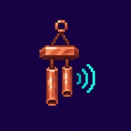

# 静听方块 ASMR / Quiet Blocks ASMR

作者：breeze0424（dazainerau@vip.qq.com）

许可证：[MIT](LICENSE)



在 Minecraft 里播放轻敲、风铃、雨点等声音。默认按 K 打开菜单，选好声音和左右移动方式，再点“播放”。

支持版本：

| 工程 | Minecraft | Forge | Java 目标版本 |
| --- | --- | --- | --- |
| `forge-26.1` | 26.1–26.1.2 | 62.0.9–64.x | 25 |
| `forge-1.16.5` | 1.16.5 | 36.2.42 | 8 |


## 功能

- 声音（Triggers）：轻敲、刮擦、风铃、村民人声、雨点敲窗、翻书、软刷、篝火。
- 位置：左右交替、环绕、随机环绕。转动视角不会改变合成音的左右位置。
- 可以在菜单里调整音量、播放间隔、左右宽度和环绕速度。
- 支持简体中文和英文。

按 **K** 或输入 `/asmr menu` 打开菜单。K 可以在游戏的按键设置里修改。
“静音”只关掉自己听到的 ASMR，游戏原声不受影响；“停止”则结束当前播放。每个玩家同时只能播放一种声音，再点“播放”会替换前一种。


## 命令

玩家控制自己：

```text
/asmr menu
/asmr play <tap|scratch|chime|voice|rain|paper|brush|fire> <alternate|orbit|random>
/asmr stop
```

OP 2 级管理员控制在线玩家：

```text
/asmr target <玩家名或选择器> play <tap|scratch|chime|voice|rain|paper|brush|fire> <alternate|orbit|random>
/asmr target <玩家名或选择器> stop
```

播放会持续到手动停止、切换声音或玩家离线。`/asmr target` 需要 OP 2 级权限。

## 配置

第一次启动后，客户端会生成 `config/asmr-client.toml`。菜单里的调整会保存到这个文件。手动改文件后，重启游戏再看效果。仓库里也有一份 [示例配置](examples/asmr-client.toml)。

| 配置项 | 默认值 | 范围 | 作用 |
| --- | ---: | ---: | --- |
| `audio.enabled` | `true` | 布尔值 | 本地允许播放 |
| `audio.volume` | `0.35` | 0–1 | ASMR 音量，会再乘以游戏主音量 |
| `audio.tapIntervalTicks` | `16` | 5–100 | 敲击间隔 |
| `audio.scratchIntervalTicks` | `24` | 5–100 | 刮擦间隔 |
| `audio.chimeIntervalTicks` | `14` | 5–100 | 风铃平均间隔；每次敲响会随机偏移 |
| `audio.voiceIntervalTicks` | `70` | 20–200 | 村民哼声间隔 |
| `audio.rainIntervalTicks` | `20` | 20–100 | 雨点敲窗片段间隔 |
| `audio.paperIntervalTicks` | `24` | 10–100 | 翻书纸页间隔 |
| `audio.brushIntervalTicks` | `20` | 20–100 | 软刷扫耳片段间隔 |
| `audio.fireIntervalTicks` | `20` | 20–100 | 篝火噼啪片段间隔 |
| `audio.radius` | `1.5` | 0.25–4 | 左右宽度 |
| `audio.orbitPeriodTicks` | `160` | 40–400 | 环绕一圈所需刻数；越小越快 |

20 Ticks约为 1 秒。除了村民人声调用游戏原有的音效，其余声音都由模组实时生成，不需要额外的音频文件。合成音走系统默认输出设备；如果游戏另选了音频设备，两边可能听起来不在同一个设备上。
